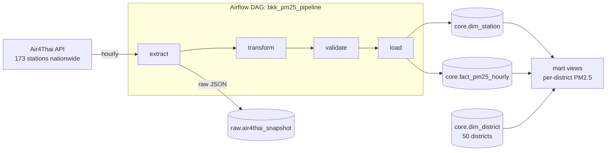

# Bangkok PM2.5 Pipeline 🌫️

An hourly data pipeline that collects PM2.5 readings from Thailand's Pollution Control Department
([Air4Thai](http://air4thai.pcd.go.th)) and lets you query air quality for **all 50 districts of Bangkok (เขต)**.

Built with **Apache Airflow 3**, **PostgreSQL** and **Docker Compose**.

```sql
SELECT * FROM mart.pm25_by_district('บางนา');
```
```
 district_th | district_en |      measured_at       | pm25 | level | stations
-------------+-------------+------------------------+------+-------+----------
 บางนา       | Bang Na     | 2026-10-11 21:00:00+07 | 10.1 | ดีมาก  | bkp72t
```

## Architecture



| Layer | Objects | Purpose |
|---|---|---|
| **raw** (bronze) | `air4thai_snapshot` | Every API response stored untouched as `jsonb`, so any day can be reprocessed |
| **core** (silver) | `dim_district`, `dim_station`, `fact_pm25_hourly` | Cleaned, typed, de-duplicated data |
| **mart** (gold) | `v_district_pm25_latest`, `v_district_pm25_hourly`, `v_district_pm25_24h`, `v_district_pm25_rolling24h`, `v_district_pm25_daily`, `pm25_by_district()` | Ready-to-query answers per district, including 24h averages to compare with the Thai standard |

### DAG tasks

| Task | What it does |
|---|---|
| `extract` | Calls the Air4Thai API and stores the full response in `raw` |
| `transform` | Keeps Bangkok stations, parses the district from the Thai address (`"แขวงคลองจั่น, เขตบางกะปิ,กรุงเทพฯ"` → `บางกะปิ`), cleans `-1` sentinel values, builds Bangkok-time timestamps |
| `validate` | Data quality gate: minimum station count, no duplicate IDs, PM2.5 within 0–1000 µg/m³. Fails the run instead of loading bad data |
| `load` | Idempotent upserts (`ON CONFLICT`), so re-running an hour never creates duplicates |

## Quick start

Requirements: Docker Desktop.

```bash
cp .env.example .env
docker compose up -d
```

- Airflow UI: http://localhost:8080 (user/password: `airflow` / `airflow`). The DAG starts unpaused and runs at minute 15 of every hour. Click ▶ to run it right away.
- Query the data:

```bash
docker compose exec postgres psql -U pm25 -d pm25
```

- Dashboard: http://localhost:8050 (district choropleth map, 50-district ranking, hourly + 24h-average trend per district; refreshes every 5 minutes).

You can also connect a GUI client (DBeaver, pgAdmin, Metabase) to `localhost:5433`, database/user/password `pm25`.
If port 8080, 5433 or 8050 is already in use, change `AIRFLOW_PORT` / `PM25_DB_PORT` / `DASHBOARD_PORT` in `.env`.

## Example queries

More queries are in [`sql/queries/examples.sql`](sql/queries/examples.sql).

```sql
-- All 50 districts right now, worst first
SELECT district_th, pm25, level, method FROM mart.v_district_pm25_latest;

-- One district over the last 3 days (Thai or English name)
SELECT * FROM mart.pm25_by_district('Chatuchak', 72);

-- Hours above the Thai 24h standard (37.5 µg/m³) in the last week
SELECT district_th, count(*) AS hours_over_standard
FROM mart.v_district_pm25_hourly
WHERE measured_at >= now() - interval '7 days' AND pm25 > 37.5
GROUP BY district_th ORDER BY 2 DESC;
```

PM2.5 levels follow the Thai Pollution Control Department bands:
0–15 ดีมาก · 15.1–25 ดี · 25.1–37.5 ปานกลาง · 37.6–75 เริ่มมีผลกระทบต่อสุขภาพ · >75 มีผลกระทบต่อสุขภาพ

## Design decisions

- **How 50 districts are covered by 59 stations.** 48 districts have at least one station of their own, and their value is the average of those stations. The other districts (currently บางคอแหลม and บึงกุ่ม) use the station nearest to the district centroid. The `method` column always shows which approach was used, so the data stays transparent.
- **24h averages, not hourly values, decide "over the standard".** The Thai PM2.5 standard (37.5 µg/m³) is a 24-hour average. `v_district_pm25_24h` and `v_district_pm25_rolling24h` compute it and expose `n_hours`, so an average built from only a few hours is visible as such.
- **Raw layer first.** The API returns only the latest hour, so the original response can't be fetched again later. Storing every payload makes the pipeline replayable if parsing logic changes.
- **`catchup=False`.** Backfilling is meaningless because the source has no history endpoint.
- **TLS without `verify=False`.** The Air4Thai server sends an incomplete certificate chain: its Let's Encrypt certificate comes with an unrelated Sectigo chain. Instead of disabling verification, the missing Let's Encrypt intermediates are vendored in [`dags/pm25/certs/`](dags/pm25/certs/) and appended to certifi's CA bundle.
- **Pure transform module.** [`dags/pm25/transform.py`](dags/pm25/transform.py) has no Airflow imports, so it is unit-tested quickly in CI.
- **No foreign key from station to district.** If a new station shows up with an unexpected address, the load still succeeds and the `validate` step logs a warning.

## Project structure

```
├── dags/
│   ├── bkk_pm25_dag.py          # Airflow DAG (TaskFlow API)
│   └── pm25/
│       ├── transform.py         # parsing + data quality rules
│       └── certs/               # missing TLS intermediates for Air4Thai
├── sql/
│   ├── init/                    # schema, district seed, mart views (run on first start)
│   └── queries/examples.sql
├── dashboard/                   # FastAPI JSON API + static map/chart page
├── tests/                       # pytest unit tests + fixture payload
├── docker-compose.yml
└── .github/workflows/ci.yml     # pytest + schema build check
```

## Tests

```bash
pip install pytest
pytest
```

CI runs the unit tests and builds the full schema against a fresh Postgres on every push.

## Roadmap

- [x] Dashboard with a district map (`dashboard/`: FastAPI + Leaflet)
- [x] Daily aggregate + 24h average views
- [ ] Alert (LINE / Discord) when a district's 24h average exceeds 37.5 µg/m³
- [ ] Move transformations to dbt
- [ ] Deploy to the cloud (GCS + BigQuery) with Terraform

## Data source

Air quality data © Pollution Control Department, Thailand ([Air4Thai](http://air4thai.pcd.go.th)).
District centroids are approximate and are used only for the nearest-station fallback.
District boundaries on the dashboard map: Royal Thai Survey Department via [OCHA HDX](https://data.humdata.org/dataset/thailand-administrative-boundaries) (CC BY-IGO), simplified.

### Upgrading an existing database

Scripts in `sql/init/` only run when the Postgres volume is first created. To add views from a newer script to a running database:

```bash
docker compose exec postgres psql -U pm25 -d airflow -f /docker-entrypoint-initdb.d/05_mart_24h.sql
```
